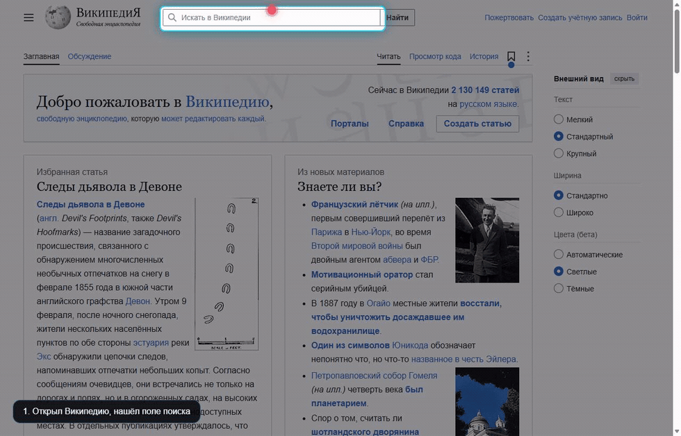

# Glean

**A browser for AI agents that sends ~330 tokens per page instead of ~34,000.**


Agents usually get a full DOM dump or an accessibility tree on every step. On a Wikipedia article the page's DOM is about 34,000 tokens — for one page view. Glean sends only what an agent can act on: visible interactive elements with short ids, plus optional text or a screenshot when needed.

```
PAGE Neural network — Wikipedia
URL https://en.wikipedia.org/wiki/Neural_network
TAB t1

e1 input:search "Search Wikipedia"
e2 button "Search"
e3 button "Hide Contents"
e4 a "History"
...
```

## Numbers

Measured on 24 November 2026 on [Neural network on Wikipedia](https://en.wikipedia.org/wiki/Neural_network): Chrome headless, 1,280×860 viewport, warm browser with a persistent profile.

| what the model receives | tokens |
|---|---|
| raw HTML, HTTP fetch of the page | ~31,400 |
| DOM after load (what a full dump sends) | 33,760 |
| visible text only | ~1,780 |
| **Glean digest** | **334** |

The digest for that page lists 56 actionable elements. Reproduce it with `npx glean <url> --json`: the CLI reports `html_tokens`, `digest_tokens` and the ratio itself.

An accessibility-tree tool sends less than a DOM dump but still an order of magnitude more than the digest. That comparison is not measured here, so no number is given for it. After an in-page action the server returns a diff instead of a new digest; its size depends on what changed.

Speed (warm browser, persistent profile): page ~1.4–2.2 s, click/type 0.4–0.9 s with verification, cached page 2 ms, plan update 3 ms.

These are cost measurements on one article and single-host tasks. They are not a task benchmark — see below.

### What is not measured yet

- **Task success rate.** A cheaper step is not automatically a better agent. Nothing here measures whether an agent completes a multi-step task (login, form, checkout) with the digest instead of a full tree.
- **Head-to-head wall-clock** against other browser tools on the same machine.
- **Long flows**: multi-tab work, repeated logins, scrolling-heavy pages, sites behind bot protection.

Until a public benchmark run exists, read the table above as "what it costs", not "how well it plays".

### Why not just Playwright MCP?

| | Playwright MCP | Glean |
|---|---|---|
| per-step payload | full DOM / accessibility tree, tens of thousands of tokens | digest ~300–900 tokens, diff ~100 |
| page navigation | new snapshot every time | digest on navigation, diff otherwise |
| screenshots | every step or on demand, full size | only when asked, JPEG, downscaled |
| cost per page view | ~10¢ | ~0.1¢ |
| warm browser | separate instance per session | persistent profile, warmed at start |

Cost per page view assumes $3 per 1M input tokens and scales linearly with the model's price. It counts input only, which is the part this table is about.

## Install

```bash
npm i glean-browser
npx playwright install chromium   # or use your system Chrome/Edge (auto-detected)
```

Run the server:

```bash
npx glean-server        # http://127.0.0.1:9879
```

One-shot digest without a server:

```bash
npx glean https://example.com
npx glean https://example.com --visual   # keep images, slower
npx glean https://example.com --json
```

## API

| endpoint | what it does |
|---|---|
| `GET /go?url=&tab=&visual=1` | open page, return compact digest |
| `POST /act` `{tab,id,action,text}` | `click` / `type` / `press` / `upload` by digest id, verified |
| `GET /diff?tab=` | only what changed since last digest |
| `GET /read?tab=&url=` | main text of the page |
| `GET /shot?tab=&visual=1&save=path` | screenshot (JPEG) |
| `GET /tab` `POST /tab` | new tab (up to `GLEAN_MAX_TABS`) |
| `GET /tabs` `GET /close?tab=` | list / close tabs |
| `GET /plan` `POST /plan` | external step plan (kept out of the model context) |
| `POST /js` `{tab,expr}` | evaluate JS in the page — off unless `GLEAN_ALLOW_JS=1` |
| `GET /health` | status |

Typical agent loop: `/go` → pick an id → `/act` → act returns a fresh digest on navigation or a diff otherwise.

`/act` re-collects the DOM before acting and re-locates the element by its kind+label key, so it keeps working on React/Vue pages that re-render and drop the `data-glean` markers between the digest and the action.

## Why it is cheaper

- only actionable elements, deduplicated and ranked (inputs → buttons → links);
- labels truncated, no styles, no scripts, no base64;
- resources blocked in fast mode (images/fonts/media/analytics);
- diffs for in-page changes;
- 45 s URL cache in the server;
- optional vision: one downscaled screenshot instead of the whole page.

## Robustness

- persistent profile (cookies, logins survive restarts);
- retries on navigation, rate limit per host (`GLEAN_MIN_GAP_MS`);
- shadow DOM and same-origin iframes are collected (elements are tagged with `data-glean`);
- stale ids return an explicit error instead of silently misclicking;
- dialogs auto-dismissed, downloads saved to the state dir;
- captcha presence reported as a flag (not solved).


## Use as an MCP server

Any MCP client (Claude Desktop, Cursor, DSH, custom agents) can use Glean instead of a DOM-dumping browser tool:

```json
{
  "mcpServers": {
    "glean": {
      "command": "npx",
      "args": ["-y", "glean-browser", "glean-mcp"],
      "env": { "GLEAN_URL": "http://127.0.0.1:9879" }
    }
  }
}
```

Tools exposed: `browser_open`, `browser_act`, `browser_read`, `browser_tabs`, `browser_plan`. The server must be running (`npx glean-server`).

## Config

| env | default | meaning |
|---|---|---|
| `GLEAN_PORT` | `9879` | HTTP port |
| `GLEAN_STATE_DIR` | `~/.glean` | profile, plan, downloads |
| `GLEAN_BROWSER` | auto | path to Chrome/Edge executable |
| `GLEAN_HEADLESS` | `1` | set `0` to watch the browser |
| `GLEAN_MAX_TABS` | `5` | tab pool size |
| `GLEAN_MIN_GAP_MS` | `700` | min delay between requests to one host |

## Limits

- captchas and Cloudflare challenges are detected, not solved;
- SPA diffs are coarse (changed count, not a structural diff);
- uploads need a concrete input element id;
- headless browser automation is known to sites you visit — use your own profile and respect their terms.

## License

MIT
